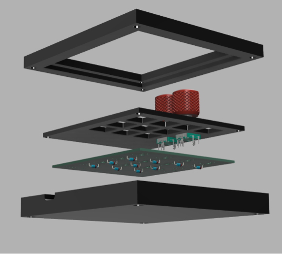
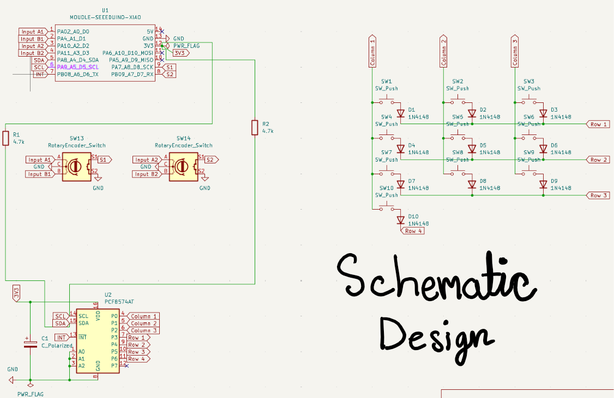

# arnav-hackpad
<b>The arnav-hackpad is a mini-keyboard (or macropad) designed to act as an external number pad with some other cool capabilities, too!</b>

## Inspiration
In my essential technology class at school, two of my favorite modules were coding and 3D printing. When I joined the [Stardance summer program](https://stardance.hackclub.com/) and started looking at the recommended projects, I saw <b>hackpad</b>, and saw it as a great way to combine my love for those two subjects.
## Features
- 2 EC11 Rotary Encoders with Switches
- 10 MX-Style Key Switches
- 3-Part Case (Top Mount style macropad)
- 2 Layers (When a layer is activated, all the keymaps change to that layer's configuration.)
## CAD Model
\
This is my assembled macropad. Click on it to interact with the assembled macropad in Autodesk Fusion's web version.\
_Note: The assembled macropad CAD model is just a quick visual. Some of the dimensions have been edited to optimize its usability. The links of the individual parts below have the correct dimensions._ 

There are 3 parts to the case: the top, the bottom, and the plate. The arnav-hackpad is top-mounted, meaning that the plate is attached to the top part. The design gives an ≈0.3mm printing tolerance. Also, there are 2 knobs I have put on top of the rotary encoders, called Hack Club Knurled Knobs. To personalize it, I added a cool design with my name on the plate, which you can see in the plate demo below!

[Click here to interact with the Plate.](https://a360.co/4g3hhWc)\
[Click here to interact with the Top part.](https://a360.co/4vbjJyh)\
[Click here to interact with the  Bottom part.](https://a360.co/4pMDXNC)\
[Click here to interact with the Hack Club Knurled Knob.](https://a360.co/4jsLTTg)
## PCB

This is my PCB's schematic design. Click on it to interact with the schematic in KiCanvas.

I used a PCF8574AT I/O expander because all of the pins would not fit on the microchip.

This is my PCB board. Click on it to interact with the PCB Board in KiCanvas.

I know it's very messy, but everything works out in the end!
## Firmware Overview
The macropad is coded using KMK firmware. Layer 0 is made to take the place of a number pad, and Layer 1 is made to take the place of a mouse and the arrow keys. For the rotary encoders, clockwise is up, and counterclockwise is down.
- On Layer 0 (Default),
    - The rotary encoder on the left changes volume, and its switch works as the mute key.
    - The rotary encoder on the right changes brightness, and its switch turns on layer 1.
    - The key switches are arranged in the same way as the numbers are in a number pad. 
- On Layer 1,
    - The rotary encoder on the left acts as a scroll wheel.
    - The rotary encoder on the right also acts as a scroll wheel, and its switch turns on layer 0.
    - The keyswitches are arranged as follows(refer to the PCB image):
        - SW1 is Left Click
        - SW2 is Up Arrow
        - SW3 is Right Click
        - SW4 is Left Arrow
        - SW5 is Down Arrow
        - SW6 is Right Arrow

_Note: All of the key arrangements can be customized by simply editing the code._
## How to make it
<b>If you need help for any part of this tutorial, Google can teach you!</b>
### Bill of Materials
To make this macropad, you will need the following:
- 10x Cherry MX Switches
- 10x 1N4148 DO-35 Diodes
- 10x DSA Keycaps
- 2x EC11 Rotary Encoder
- 2x Hack Club Knurled Knob (Replaceable with another knob for EC11 Rotary Encoder)
- 1x Seeed Studio XIAO RP2040
- 1x PCF8574AT
- 1x 0805 SMD Ceramic Capacitor - 100 nF, 50 V, ±10%
- 2x 0805 SMD Pull-Up Resistors - 4.7 kΩ
- 4x M3 x D5mm x L4mm Heatset Inserts
- 4x M2 x D4mm x L3mm Heatset Inserts
- 4x M3 x 16mm screws
- 4x M2 x 4mm screws
- 1x Case (3 printed parts)
- 1x USB-C cable
- 1x Soldering Iron
### Installing the Firmware
Download the [Production folder](Production/Firmware) onto your computer. [This guide](https://wiki.seeedstudio.com/XIAO-RP2040-with-CircuitPython/), from Seeed Studio, is great to help you import the firmware. Drag the files <b>out of the folder</b> and into the drive. Make sure every file and folder is in the drive when you're done. The code can still be edited after you put it in the drive!
### PCB
Use the [Gerbers.zip file](Production/Gerbers.zip) to print the PCB from whatever company you want. Make sure you choose the <b>2-layer</b> PCB option. When you solder the components together, make sure to refer to the [online PCB image](https://kicanvas.org/?repo=https%3A%2F%2Fgithub.com%2Farnavshah100%2Farnav-hackpad%2Fblob%2Fmain%2FPCB%2FKiCad%2520file.kicad_pcb) often. I recommend soldering the components in this order:
1. Diodes
2. Microcontroller and I/O Expander (XIAO RP2040 and PCF8574AT)
3. Ceramic Capacitors and Pull-Up Resistors
4. Rotary encoders
5. Mount keyswitches on plate in direction shown on PCB <b>FIRST</b>, and <b>THEN</b> solder them on.
### 3D Printing
Use the [Plate.step file](Production/CAD%20files/Plate.step), [Top.step file](Production/CAD%20files/Top.step), [Bottom.step file](Production/CAD%20files/Bottom.step), and [Hack Club Knurled Knob.step file in case you are using it](Production/CAD%20files/Hack%20Club%20Knurled%20Knob.step). If you are printing it yourself, I suggest using google to figure out how to print on your specific 3D printer. Otherwise, just give the files above to whoever is printing it. Make sure you use either PLA, ABS, PETG, or Nylon, because certain plastics don't work with heatset inserts.
### Assembly

Finally, it's time to do the assembly! Put the M3 x D5mm x L4mm heatset inserts on the outer holes of the top part, and put the M2 x D4mm x L3mm heatset inserts on the inner holes of the top part. You can use [this image](Assets/ScrewImage.png) to help you.

Next, <b><i><u>carefully</u></i></b> solder the keyswitches onto the PCB.

For the last step, use the M2x4mm screws to screw the plate onto the top part's M2 heatset insert. The top part of the screw should be touching the plate. I recommend plugging in the PCB into your device and trying using the macropad to check that it works. If your device doesn't register any of the keypresses, reread all the steps in [the guide](https://github.com/arnavshah100/arnav-hackpad/#how-to-make-it). Use the M3x16mm screws to screw the bottom part onto the top part's M3 heatset insert. The top part of the screw should be touching the bottom part. The labeled image showing where the screws should be is [here](Assets/Assembly.png).

Now, put the knob on the rotary encoder, and you're DONE! 

<b><u>CELEBRATE!</u></b>
## License
The code is under an MIT License. For more info, see [LICENSE](LICENSE).
## Credits
- Huge thanks to [@ashah80](https://github.com/ashah80) (my brother!), who helped me in every step of the way, even though he has never made anything hardware-related.
- I was motivated by the [Stardance summer program](https://stardance.hackclub.com/), which both inspired and incentivized me to make this project. I had never even considered making anything related to hardware before Stardance provided me with a great platform to do so.
- The people in the [hackpad slack page](https://hackclub.enterprise.slack.com/archives/C07LESGH0B0) from Hack Club helped answer all my questions.
### Resources I used
- I used [Hack Club's KiCad care package](https://github.com/hackclub/hackpad/releases/tag/v0.1-bugfix) for some of my symbols and footprints in my PCB.
- I used [KiCad's rotary encoder footprint](https://kicad.github.io/footprints/Rotary_Encoder) for my, well, rotary encoder!
- I used [Hack Club's rotary encoder and knurled knob CAD file](https://github.com/hackclub/hackpad/tree/clean/extras/CAD%20models) in my [assembled hackpad file](CAD/arnav-hackpad.step).
- I used some of the [KMK's CircuitPython libraries](https://github.com/KMKfw/kmk_firmware), a key part of my code.
- I used [CircuitPython's code language interpreter](https://circuitpython.org/board/seeeduino_xiao_rp2040/) as the main software.

<b>Thank you for <i>reading me</i>!</b>

